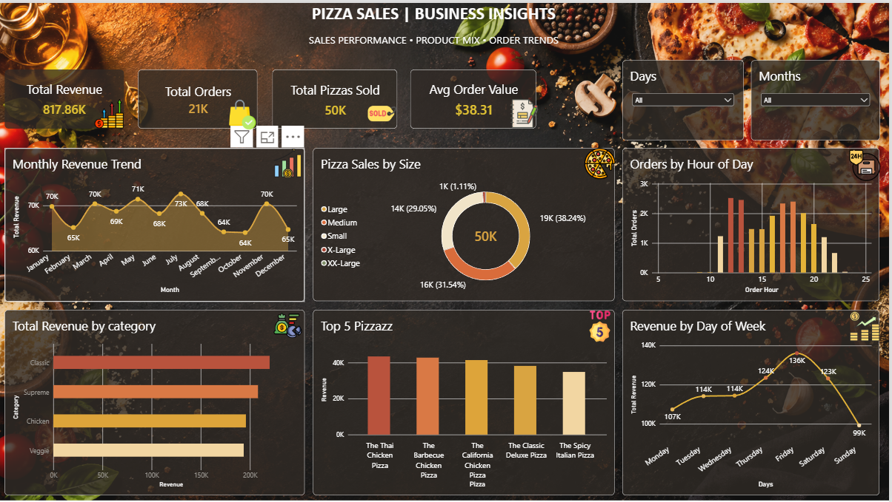

# Pizza-Sales-Dashboard

> **Business question:** Which pizzas, sizes, and time slots drive the most revenue, and how can the restaurant use that to plan its menu, promotions, and staffing?

A Power BI dashboard built on one year of pizza order data that tracks revenue, orders, and average order value, and shows what sells, when it sells, and in which size.

---

## Dashboard




---

## 1. Problem statement

A pizza restaurant needs to know what drives its sales. Without a clear view of revenue by category, size, and time of day, menu decisions and staffing are based on guesswork. This dashboard turns raw order data into KPIs and trends, so the team can see which products earn the most, when demand peaks, and where to focus promotions.

## 2. Dataset

| Item | Detail |
|------|--------|
| File | `pizza_sales` |
| Rows | 48,620 order line items |
| Orders | 21,350 unique orders |
| Period | 01 Jan 2015 to 31 Dec 2015 |
| Pizza types | 32 (91 type and size combinations) |
| Categories | Classic, Supreme, Chicken, Veggie |
| Sizes | Small, Medium, Large, X-Large, XX-Large |

**Columns:** `order_details_id`, `order_id`, `pizza_id`, `quantity`, `size`, `price`, `total_price`, `name`, `pizza_type_id`, `category`, `ingredients`, `order_time`

## 3. KPIs tracked

| KPI | Value | Meaning |
|-----|-------|---------|
| Total Revenue | $817.9K | Sum of all line-item sales |
| Total Orders | 21,350 | Unique orders placed |
| Total Pizzas Sold | 49,574 | Total quantity sold |
| Average Order Value | $38.31 | Revenue per order |

## 4. Dashboard contents

- **KPI cards:** Total Revenue, Total Orders, Total Pizzas Sold, Average Order Value
- **Revenue by category** (bar chart)
- **Revenue by pizza name and size** (column chart, to spot top performers)
- **Pizzas sold by size** (donut chart)
- **Monthly revenue trend** by size (line chart)
- **Revenue by day of week** (line chart)
- **Orders by hour of day** (column chart)
- **Slicers:** month and day of week for interactive filtering

## 5. Key findings

- The restaurant made **$817.9K** from **21,350 orders** and **49,574 pizzas**, with an average order value of **$38.31** (about 2.3 pizzas per order).
- **Large pizzas** bring in about **46%** of revenue, followed by Medium (30.5%) and Small (21.8%). X-Large and XX-Large together are under 2%.
- **Classic** is the top category by revenue (26.9%) and sells the most units (14,888), but the four categories are close (23.7% to 26.9%), so the menu is well balanced.
- Top pizzas by revenue: **The Thai Chicken Pizza** ($43.4K), **The Barbecue Chicken Pizza** ($42.8K), and **The California Chicken Pizza** ($41.4K).
- Most units sold: **The Classic Deluxe Pizza** (2,453), **The Barbecue Chicken Pizza** (2,432), and **The Hawaiian Pizza** (2,422).
- Lowest earner: **The Brie Carre Pizza** ($11.6K).
- Orders peak at **12 PM to 1 PM** (lunch) and **5 PM to 6 PM** (dinner).
- **Friday** is the busiest day (3,538 orders) and **Sunday** the quietest (2,624).
- **July** is the best month ($72.6K) and **October** the weakest ($64.0K).

## 6. Recommendations

1. **Staffing:** schedule more staff for the lunch (12 to 1 PM) and early dinner (5 to 6 PM) rushes, and on Fridays.
2. **Menu focus:** promote the Chicken pizzas (Thai, Barbecue, California), which lead on revenue.
3. **Size strategy:** push Large pizzas in combos and upsells, since they drive nearly half of revenue.
4. **Review low performers:** check whether low-revenue pizzas like Brie Carre should be promoted, repriced, or replaced.
5. **Slow periods:** run offers on Sundays and in weaker months (September and October) to lift demand.

## 7. Power BI measures

```
Total Revenue = SUM(pizza_sales[total_price])

Total Orders = DISTINCTCOUNT(pizza_sales[order_id])

Total Pizzas Sold = SUM(pizza_sales[quantity])

Average Order Value = DIVIDE([Total Revenue], [Total Orders], 0)

Order Hour = HOUR(pizza_sales[order_time])
```

A `DateTable` is used for the month and day-of-week slicers. Change the table and column names to match your model.

## 8. Repository structure

```
Pizza-Sales-Dashboard/
├── pizza_dash.pbix      Power BI dashboard file
├── pizza_sales.csv      Dataset
├── Dashboard.png        Dashboard screenshot
└── README.md
```

## 9. How to use

1. Download or clone the repository.
2. Open `pizza_dash.pbix` in Power BI Desktop.
3. If the data path breaks, go to **Transform data > Data source settings** and point the source to `pizza_sales.csv`.
4. Use the month and day slicers to explore trends.

## 10. Tools used

- Power BI Desktop (dashboard and visuals)
- DAX (measures and date table)
- CSV (source data)

## Author

**Himanshu Meshram**
[LinkedIn](https://www.linkedin.com/in/your-linkedin-username) | [GitHub](https://github.com/your-github-username) | himanshumeshram0703@gmail.com
